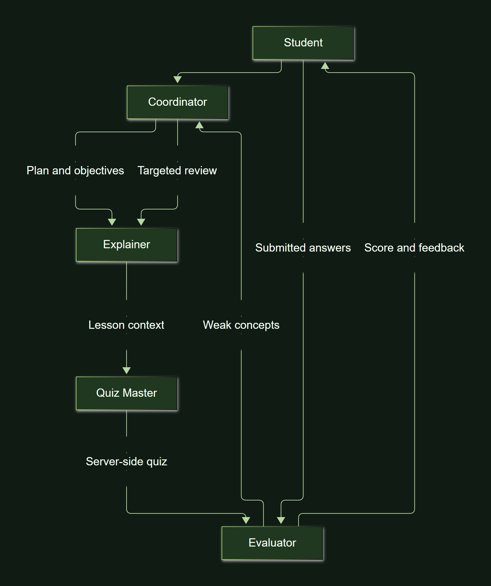
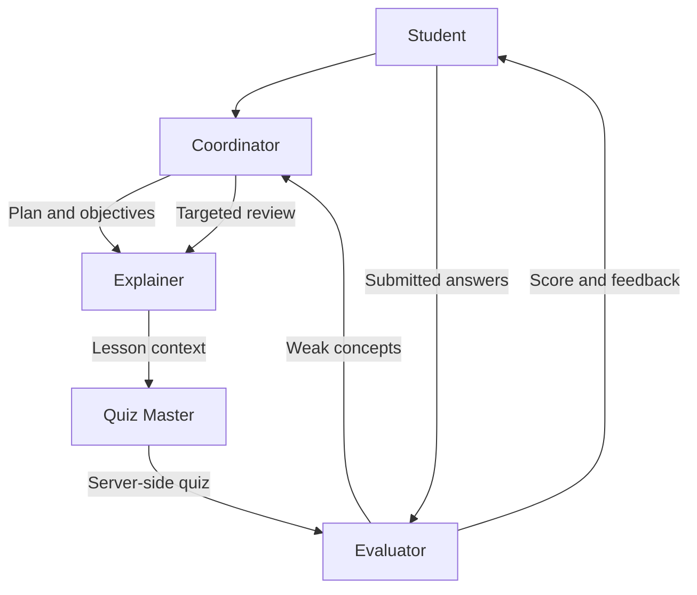

# Leo AI Tutor

Leo AI Tutor is a Streamlit workspace for AI-assisted study. Sign in, choose a topic and difficulty, work through a lesson, take a quiz, and review feedback with a four-agent CrewAI team. The app supports English and Bangla lessons, follow-up questions, simpler or more detailed explanations, and targeted review.

## Run locally

On Windows, double-click `start.bat` in the repository folder. It uses Python 3.12 or `uv` to set up the project if needed and opens Leo AI Tutor in your default browser. Keep the launcher window open while you use the app. Press Ctrl+C in that window to stop the server.

The launcher creates `.env` from `.env.example` on the first run if the file is missing. Set your provider credentials in `.env` before starting a lesson.

### Manual setup

Use Python 3.12 and open a PowerShell terminal in the repository directory.

```powershell
python -m venv .venv
.venv\Scripts\python.exe -m pip install -r requirements.txt
Copy-Item .env.example .env
```

Set `LLM_MODEL` and `LLM_API_KEY` in `.env` using one of these configurations. The app reads the file when starting an agent stage. Nonempty environment variables take precedence.

| Provider | `LLM_MODEL` example | Other configuration |
| --- | --- | --- |
| OpenAI | `openai/gpt-4o-mini` | Set `LLM_API_KEY` to your OpenAI key. |
| Gemini | `gemini/gemini-2.5-flash` | Set `LLM_API_KEY` to your Gemini key. |
| OpenAI-compatible endpoint | `org/model` | Set `LLM_API_KEY` and `LLM_BASE_URL`, such as `https://your-endpoint.example/v1`. |

```powershell
.venv\Scripts\python.exe -m streamlit run app.py
```

If using the virtual environment prepared in the parent workspace, use `..\.venv\Scripts\python.exe`. On macOS or Linux use `.venv/bin/python` and `cp .env.example .env`.

Create an account with a student name and a password of at least eight characters. Open **Learning Session** and study **Python Loops** at **Beginner** difficulty. Try asking a follow-up question, answer one quiz question incorrectly, and take the follow-up quiz through **Re-teach weak concepts**. Finish the session and reopen it from **Study History**.

### Optional server settings

| Environment variable | Default | Purpose |
| --- | --- | --- |
| `MAX_RETEACH_ROUNDS` | `2` | Maximum review rounds per session. Accepted values are 0–5. |
| `LEO_DATABASE_PATH` | `.data/leo.sqlite3` | Path to the SQLite database on the server. |

Student accounts are local to the deployment. A browser refresh can require signing in again. Sign in with the same account to resume a lesson, see a running agent stage, or restore saved quiz selections.

## Agent workflow



<details>
<summary>Mermaid source</summary>



</details>

The Coordinator validates the request and can ask for clarification. For worker stages it serves as CrewAI's manager in a hierarchical crew and delegates to the appropriate worker. Lesson, quiz and evaluation handoffs use completed task outputs in CrewAI's task context. The Explainer answers follow-up questions using the saved conversation and lesson. The Quiz Master generates validated choices and answer keys. The Evaluator adds feedback and suggestions, while Python calculates and persists the score and missed concepts from the answer key. Role instructions live in `prompts/`.

Streamlit calls server-side services. Agent work runs in a bounded worker pool with per-call and agent time limits and one retry. The interface polls stored activity while work is in progress and displays recorded status, outcomes, timestamps and handoffs. Temporary failures return the session to the retryable step. If the server restarts mid-job, a 12-minute job timeout releases the interrupted step.

## Data and access

SQLite initializes schema version 1 on first access. It stores student preferences, owned sessions, activity events and historical quiz attempts. The database keeps the quiz answer key on the server and checks session ownership on each read or write. Session changes and quiz submission are transactional, and each quiz can create only one attempt. Passwords are individually salted and hashed with scrypt.

The former name-keyed JSON history is preserved on disk. Existing JSON records have no ownership credentials, so the app does not link them to newly created accounts based on names. For a public deployment, serve the app behind HTTPS with appropriate login rate limiting and keep the SQLite file on persistent storage. Account recovery and multi-instance job scheduling require deployment-specific services.

## Tests

```powershell
.venv\Scripts\python.exe -m unittest discover -s tests -v
```

The tests exercise Streamlit with CrewAI and scripted responses in a temporary database. They verify clarification, lesson follow-ups, explanation revisions, difficulty changes, invalid quiz retry, answer validation, deterministic scores, re-teaching, attempt history, session completion, resume, duplicate submission, provider failure and account isolation. Scripted tests require no provider credentials.
